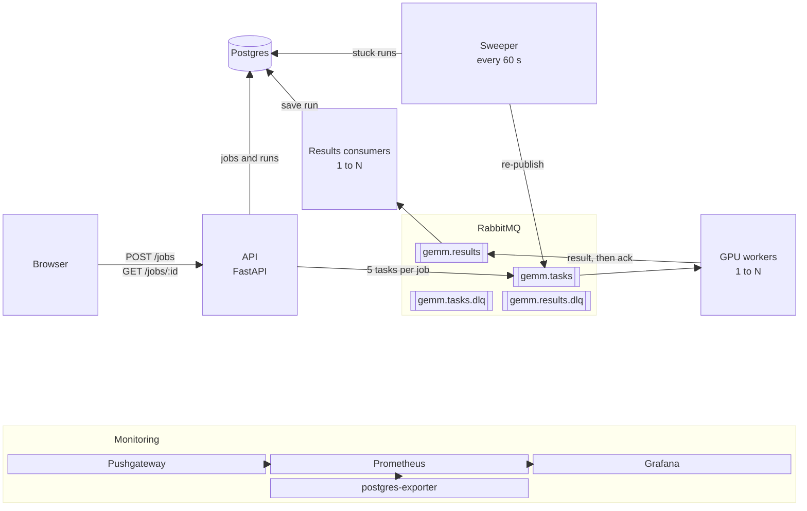
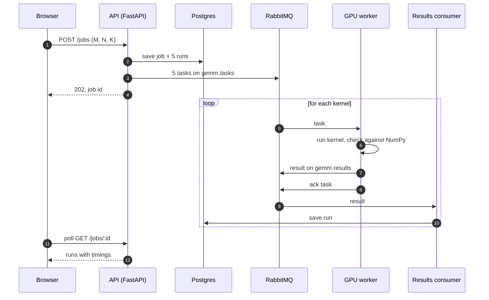

# gemm-queue

A small job system for running GPU matrix-multiplication kernels. You submit M, N and K in a web page; the API queues one task per kernel on RabbitMQ; a GPU worker runs five AMD HIP and rocBLAS kernels, checks every result against NumPy, and the timings come back to the page.

The kernels are the workload. The project is mostly about the system around them: queueing, retries, dead-letter handling, and making sure results are never silently lost.



One job through the system:



## Design

- **At-least-once delivery.** The worker acks a task only after its result is published, and results are written by task ID, so a redelivered task or a duplicate result changes nothing.
- **Dead-letter queues on both sides.** A task that keeps failing goes to `gemm.tasks.dlq` after 4 attempts; a malformed result goes straight to `gemm.results.dlq`. Database errors are retried with a pause instead of burning through the delivery limit.
- **Results consumer as its own service.** It used to run inside the API process. Load tests showed that process was the bottleneck: saving results halved how many jobs it could accept, and `gemm.results` grew while `gemm.tasks` stayed empty. Now it runs separately and scales with `RESULTS=N`. The numbers are in [docs/load-tests.md](docs/load-tests.md).
- **Row lock per job.** Results of one job are saved in parallel, by one consumer or by several replicas, so the job row is locked while a run is written. An integration test reproduces the race without the lock (5 of 5 runs left jobs stuck) and passes with it, running two consumers.
- **Sweeper batch job.** Every 60 s it looks for runs with no result after 10 minutes, re-publishes their task, and marks them failed after 3 attempts, so every job ends as done or failed.
- **Metrics.** The API serves `/metrics` for Prometheus to pull; the workers, results consumers and sweeper push theirs to a Pushgateway; RabbitMQ and Postgres are scraped through their exporters. Each sweeper pass is also logged in a `sweeper_runs` table.
- **Pluggable runner.** `HipRunner` calls the compiled HIP binary; `FakeRunner` returns the NumPy product, so the whole pipeline runs and is tested without a GPU.

## Load tests

Each part measured at its peak on its own, then the whole system, on one 32-thread machine with fake workers (64³ matrices), so this is the system around the kernels. Details, method and history in [docs/load-tests.md](docs/load-tests.md).

| Part | Peak on its own |
|---|---|
| API (one process) | ~410 jobs/s = ~2,050 tasks/s |
| 16 workers | ~2,570 tasks/s |
| 4 / 8 results consumers | ~2,140 / ~3,040 results/s |
| Whole system (16 workers, 4+ consumers) | 1,400–1,700 tasks/s, queues stay empty |

The API is the bottleneck: one Python process at ~1.1 cores, while the workers, consumers, RabbitMQ and Postgres all have room. Four results consumers keep up with what it sends.

## Failure tests

`make test-chaos` breaks the running stack under load, one fault per test, then checks that every job the API accepted (202) finished, every run completed and nothing ended up in a dead-letter queue. The sweeper's timeout is shortened to 20 s for the run.

| Fault | Jobs accepted | Requests that failed | Runs re-published by the sweeper | What recovered it |
|---|---|---|---|---|
| Worker killed mid-task | 716 | 0 | 0 | RabbitMQ redelivers its unacked task |
| Results consumer killed mid-save | 724 | 0 | 0 | redelivery; saving a result twice changes nothing |
| RabbitMQ restarted | 1,088 | 0 | 900 | the sweeper |
| Postgres restarted | 1,084 | 8 | 0 | the consumers' retry; the client saw the 8 failures |
| Queued tasks lost (queue purged) | 844 | 0 | 540 | the sweeper |

When RabbitMQ restarts, the API still answers 202: the job is saved, its tasks fail to publish, and the sweeper publishes them later. Nothing is lost, but with the real 10 minute timeout those jobs wait 10 minutes. Retrying the publish in the API, or an outbox, would shorten that.

## GPU results

One 8192 × 8192 × 8192 job on a Radeon 8060S (gfx1151, ROCm 7.2.1), averaged over 5 timed runs after a warm-up:

| Kernel | Time | TFLOPS | Max relative error |
|---|---|---|---|
| naive | 3670 ms | 0.30 | 4.3e-6 |
| lds (shared-memory tiles) | 1009 ms | 1.09 | 4.3e-6 |
| half2 (packed fp16) | 438 ms | 2.51 | 4.9e-4 |
| rocBLAS sgemm | 506 ms | 2.17 | 4.4e-6 |
| rocBLAS fp16 | 37 ms | 29.6 | 4.9e-4 |

`half2` stores A and B in fp16, so it beats rocBLAS sgemm at the cost of precision. It needs even K and N; other sizes fail on purpose and the error is shown on the page.

## Running it

Needs Podman with Compose, [uv](https://docs.astral.sh/uv/), Node and, for the GPU worker, an AMD GPU with ROCm.

```sh
cp .env.example .env     # set the passwords and API_KEY
make up                  # builds both images, starts Postgres, RabbitMQ, API, results consumer, worker, sweeper and monitoring
make load-test           # optional: submit 20 jobs to watch
```

Then open http://localhost:8000 for the app and http://localhost:3000 for the Grafana dashboard. For a GPU other than gfx1151, run `make up GPU_ARCH=gfx1100` (or whatever `rocminfo` reports).

The number of workers, their runner and the number of results consumers can be set when starting:

```sh
make up WORKERS=4 RUNNER=fake RESULTS=2   # 4 fake workers (NumPy instead of the GPU), 2 results consumers
make worker WORKERS=1                     # scale only the workers, runner from WORKER_RUNNER in .env
make results RESULTS=1                    # scale only the results consumers
```

Without a GPU, run the worker on the host with the fake runner:

```sh
make db mq build-frontend migrate
make run-api                         # in one terminal
make run-results                     # in another
WORKER_RUNNER=fake make run-worker   # in a third
```

## Tests

```sh
make test               # 75 unit tests, no services needed
make test-integration   # 11 tests against real Postgres and RabbitMQ (make db mq first)
make test-chaos         # 5 failure tests against the running stack (make up RUNNER=fake WORKERS=4 RESULTS=2)
make lint               # ruff, oxlint and pre-commit checks
```

## Layout

```
gemm_queue/common/    shared settings, enums, messages, RabbitMQ helpers
gemm_queue/api/       FastAPI routes, database, migrations
gemm_queue/results/   results consumer (its own service)
gemm_queue/worker/    task handler, runners, HIP kernel source
gemm_queue/batch/     sweeper (batch job)
gemm_queue/frontend/  React + Vite page
deploy/               docker-compose.yml, the two Dockerfiles, Prometheus and Grafana config
scripts/              load generator and benchmark
docs/                 load test results
tests/                unit/, integration/ and chaos/ (failure tests)
```
