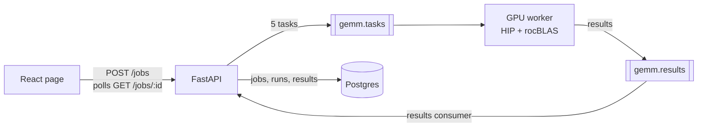

# gemm-queue

A small job system for running GPU matrix-multiplication kernels. You submit M, N and K in a web page; the API queues one task per kernel on RabbitMQ; a GPU worker runs five AMD HIP and rocBLAS kernels, checks every result against NumPy, and the timings come back to the page.

The kernels are the workload. The project is mostly about the system around them: queueing, retries, dead-letter handling, and making sure results are never silently lost.



## Design

- **At-least-once delivery.** The worker acks a task only after its result is published, and results are written by task ID, so a redelivered task or a duplicate result changes nothing.
- **Dead-letter queues on both sides.** A task that keeps failing goes to `gemm.tasks.dlq` after 4 attempts; a malformed result goes straight to `gemm.results.dlq`. Database errors are retried with a pause instead of burning through the delivery limit.
- **Row lock per job.** Results of one job are saved in parallel, so the job row is locked while a run is written. An integration test reproduces the race without the lock (5 of 5 runs left jobs stuck) and passes with it.
- **Pluggable runner.** `HipRunner` calls the compiled HIP binary; `FakeRunner` returns the NumPy product, so the whole pipeline runs and is tested without a GPU.

## Results

One 8192 × 8192 × 8192 job on a Radeon 8060S (gfx1151, ROCm 7.2.1), averaged over 5 timed runs after a warm-up:

| Kernel | Time | TFLOPS | Max relative error |
|---|---|---|---|
| naive | 3670 ms | 0.30 | 4.3e-6 |
| lds (shared-memory tiles) | 1009 ms | 1.09 | 4.3e-6 |
| half2 (packed fp16) | 438 ms | 2.51 | 4.9e-4 |
| rocBLAS sgemm | 506 ms | 2.17 | 4.4e-6 |
| rocBLAS fp16 | 37 ms | 29.6 | 4.9e-4 |

`half2` stores A and B in fp16, so it beats rocBLAS sgemm at the cost of precision. It needs even K and N; other sizes fail on purpose and the error is shown on the page.

## Running it

Needs Podman with Compose, [uv](https://docs.astral.sh/uv/), Node and, for the GPU worker, an AMD GPU with ROCm.

```sh
cp .env.example .env     # set the passwords and API_KEY
make up                  # builds both images, starts Postgres, RabbitMQ, API and worker
```

Then open http://localhost:8000. For a GPU other than gfx1151, run `make up GPU_ARCH=gfx1100` (or whatever `rocminfo` reports).

Without a GPU, run the worker on the host with the fake runner:

```sh
make db mq build-frontend migrate
make run-api                         # in one terminal
WORKER_RUNNER=fake make run-worker   # in another
```

## Tests

```sh
make test               # 65 unit tests, no services needed
make test-integration   # 5 tests against real Postgres and RabbitMQ (make db mq first)
make lint               # ruff, oxlint and pre-commit checks
```

## Layout

```
gemm_queue/common/    shared settings, enums, messages, RabbitMQ helpers
gemm_queue/api/       FastAPI routes, results consumer, database, migrations
gemm_queue/worker/    task handler, runners, HIP kernel source
gemm_queue/frontend/  React + Vite page
deploy/               docker-compose.yml and the two Dockerfiles
tests/                unit/ and integration/
```
